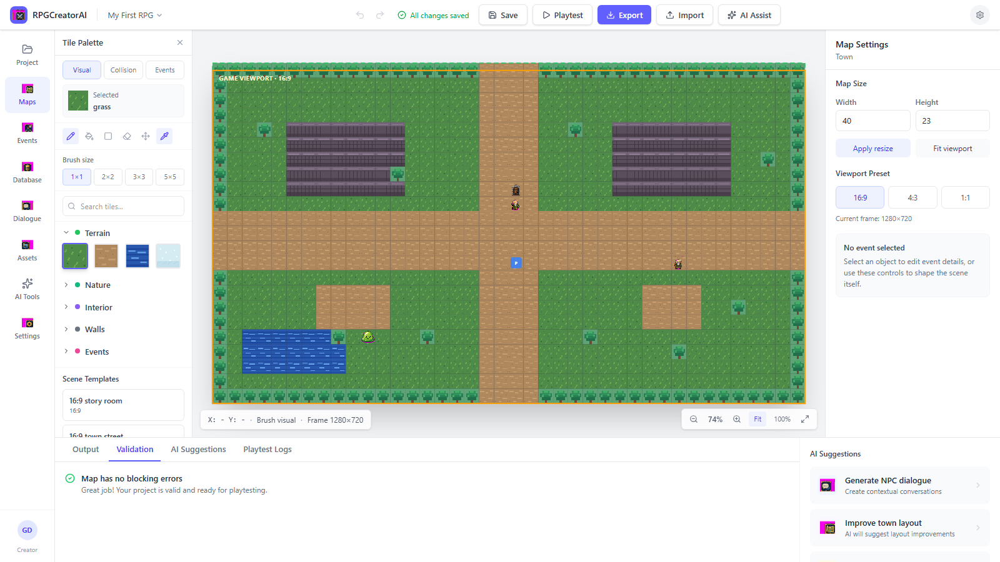
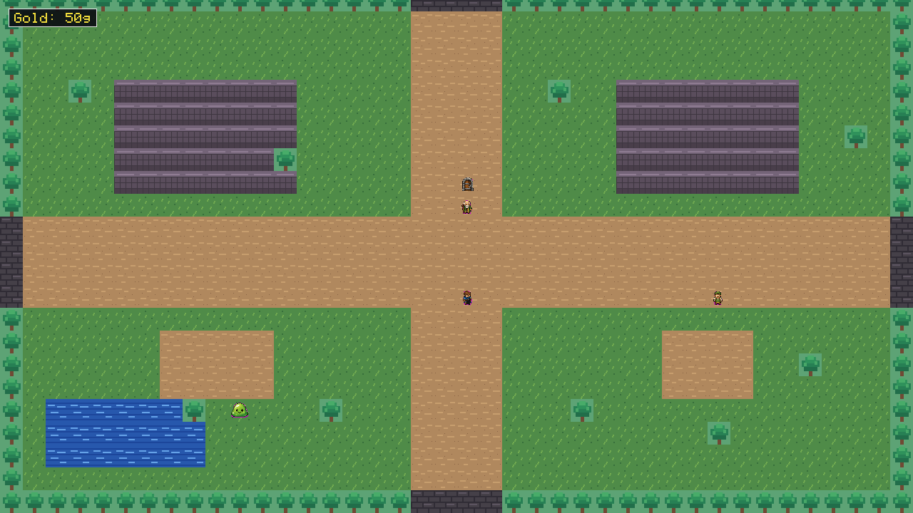
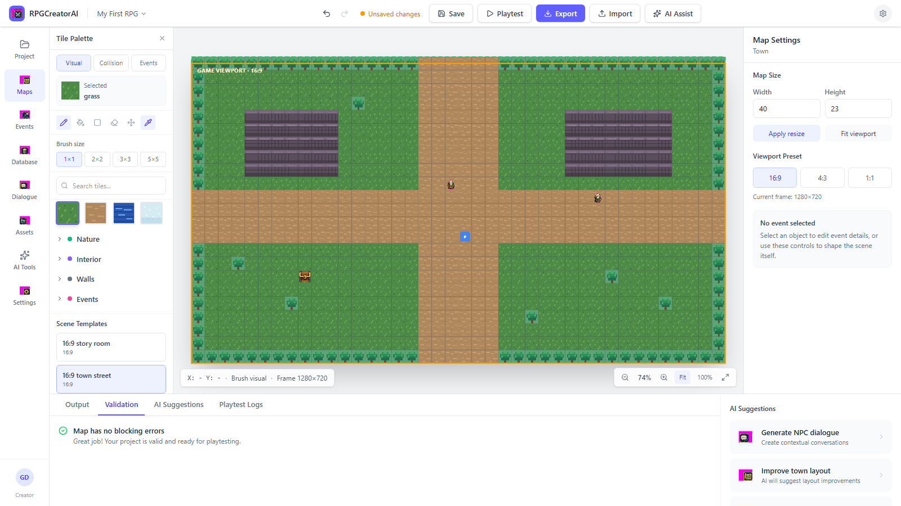
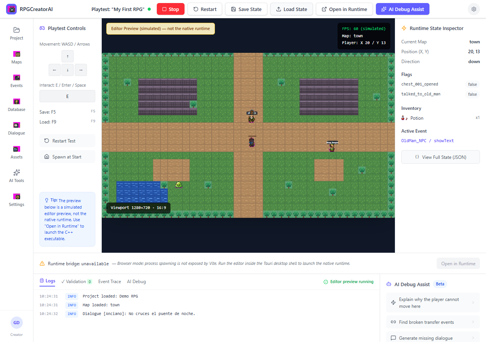

# RPGCreatorAI

RPGCreatorAI is an experimental open source RPG creation toolkit: a React/Tauri
editor paired with a native C++ runtime. The project starts from a professional
RPG Maker-style workflow and is being built into a local-first product platform
with optional AI-assisted editor tooling. The native runtime stays local,
deterministic, and data-driven.



## Why This Exists

Most RPG creation tools are either closed, plugin-heavy, or hard to automate.
RPGCreatorAI is designed as a hackable editor/runtime stack where game data
stays in JSON, the runtime interprets data instead of hardcoding content, and
AI-assisted authoring can draft or review editor data without becoming a
runtime dependency.

The project is useful for:

- developers exploring data-driven RPG engines
- creators who want a local-first RPG editor
- contributors interested in AI-assisted authoring workflows
- maintainers experimenting with Codex-assisted development loops

## Current Status

RPGCreatorAI is in active alpha development.

Implemented foundations include:

- React 19 + Vite editor UI
- Tauri 2 desktop shell integration
- native C++20 runtime built with CMake
- startup flows for opening, creating, importing, and using sample projects
- data-driven maps, layers, event pages, switches, variables, common events, database shards, shops, battles, and save state
- local playtest sessions for project start, current map, and selected event modes
- bounded runtime logs, deterministic event traces, and runtime state snapshots in the Playtest screen
- shared JSON project format between editor and runtime
- generated runtime/editor visual assets and asset workflow helpers
- optional editor-side Provider Hub surfaces, offline mock provider contracts,
  generation queues, generation history, cost/rate-limit states, and provider
  credential boundaries
- C++ runtime tests, Vitest editor tests, and validation scripts

AI is not required to run the editor or runtime. Provider-backed tooling is
optional, disabled by default, and validated with local mocks during normal
development. The current product does not ship a scripting VM, cloud service,
marketplace, proprietary importer, signed installer, or runtime AI dependency.
Live paid provider calls are outside normal validation and require explicit
credentials and opt-in.

## Screenshots

| Editor map view | Runtime view |
| --- | --- |
|  |  |

| Scene template | Playtest preview |
| --- | --- |
|  |  |

## Repository Layout

```text
src/                 React editor, adapters, stores, validation, and C++ runtime source
src-tauri/           Tauri desktop shell
data/                sample RPG project JSON consumed by editor and runtime
assets/generated/    generated visual assets for editor and runtime
tests/               C++ runtime tests
docs/                architecture, data format, validation logs, screenshots, roadmap
scripts/dev/         Windows build, verify, smoke, and asset scripts
.kiro/specs/         implementation specs used during agent-driven development
```

## Requirements

Frontend/editor:

- Node.js 22 recommended
- npm 10+

Runtime on Windows:

- Visual Studio 2022 Build Tools or Visual Studio with the C++ workload
- CMake
- Ninja

Desktop shell:

- Rust stable toolchain
- Tauri 2 dependencies

See [Windows Build Notes](docs/WINDOWS_BUILD_NOTES.md) for the current tested runtime setup.

## Quick Start

```bash
npm install
npm run dev
```

Open the printed Vite URL in your browser. `npm run dev` uses browser mode:
edits stay in the browser adapter until exported, and native runtime launch,
runtime logs, and runtime state snapshots are unavailable by design.

For the desktop shell with real filesystem save/load and native runtime
launch:

```bash
npm run desktop:dev
```

Tauri starts the strict dev server on `http://localhost:1420`.

For the normal creator loop, use desktop mode, open or create a project, edit
maps/events/database/assets, run Validate, Save, then launch Playtest from the
Playtest screen. For a local unsigned Windows package prototype, use
`npm run desktop:package:windows`.

## Verify The Project

Canonical Windows local gate:

```powershell
powershell -NoProfile -ExecutionPolicy Bypass -File scripts/dev/verify.ps1
```

This runs frontend typecheck, Vitest, frontend build, native C++
configure/build/CTest, Tauri content verification, Rust desktop tests,
runtime smoke, and editor-runtime roundtrip validation. A successful run ends
with `=== ALL PASSED ===`.

NPM alias:

```powershell
npm run verify:windows
```

Known nonfatal warnings in the current Windows environment include the Vite
chunk-size warning, CMake FetchContent CMP0135 developer warnings, dependency
`cmake_minimum_required` deprecation warnings, missing PkgConfig, missing
optional sample audio files, and WASAPI/audio-device warnings during runtime
smoke. These are expected only when the command still reports PASS.

Frontend and editor checks:

```bash
npm run typecheck
npm test
npm run build
```

Windows runtime build and C++ tests:

```powershell
powershell -NoProfile -ExecutionPolicy Bypass -File scripts/dev/verify.ps1 -SkipFrontend -SkipDesktop -SkipSmoke
```

Restricted-execution-policy fallback for the full local gate:

```cmd
scripts\dev\verify.bat
```

Manual CMake diagnosis on Windows should use the out-of-OneDrive preset:

```cmd
cmake --preset windows-dev
cmake --build --preset windows-dev
ctest --preset windows-dev
```

Runtime smoke check:

```powershell
powershell -NoProfile -ExecutionPolicy Bypass -File scripts/dev/smoke-runtime.ps1
```

Runtime diagnostics check:

```powershell
powershell -NoProfile -ExecutionPolicy Bypass -File scripts/dev/verify-diagnostics.ps1
```

Desktop content check, with a Tauri dev server already running on port 1420:

```bash
npm run desktop:verify-content
```

Local unsigned Windows package prototype:

```powershell
npm run desktop:package:windows
```

That helper builds the frontend, Tauri shell, and native runtime, copies
`rpg_creator_runtime.exe` beside the packaged Tauri executable under
`%LOCALAPPDATA%\RPGCreatorAI\tauri-target\debug`, and smoke-launches the
packaged app. A successful run prints `PACKAGED SMOKE PASSED` and
`=== WINDOWS PACKAGE PROTOTYPE PASSED ===`. It does not create an installer or
require signing credentials.
Restricted-execution-policy fallback:

```cmd
scripts\dev\package-windows.bat
```

The current release artifact and future installer policy is documented in
[Phase 11 Release Artifact Policy](docs/PHASE_11_RELEASE_ARTIFACT_POLICY.md).
First-run directories and cleanup policy are documented in
[First-Run App Data Policy](docs/FIRST_RUN_APP_DATA_POLICY.md). Runtime
diagnostic folders, log caps, and failed-launch troubleshooting are documented
in [Diagnostics And Logs](docs/DIAGNOSTICS.md).

## Current Editor Workflow

1. Open the editor in the browser for quick preview or with `npm run desktop:dev` for real filesystem/runtime integration.
2. Open an existing project, create a new project, import a project bundle, or use the sample JSON project under `data/`.
3. Edit maps with ground, decoration, foreground, collision, region, and event authoring layers.
4. Edit event pages, commands, common events, and database shards from the editor screens.
5. Use Validate, then Save. Desktop mode writes through the Tauri filesystem bridge; browser mode uses the browser adapter/export path.
6. Use Playtest mode selectors for Project Start, Current Map, or Selected Event.
7. In desktop mode, Open in Runtime builds a temporary playtest project root and launches the native C++ runtime from that temp root. Source project files are not mutated by playtest launch.
8. Inspect Runtime Log, Event Trace, and Runtime State in the Playtest screen. Browser mode shows honest unavailable states for native-only surfaces.
   The Runtime Log tab displays the local diagnostics folder even before the
   first native log exists.

## Optional AI Editor Tooling

AI/provider features are editor tooling, not runtime requirements. Current
Phase 11 infrastructure includes Provider Settings, capability gates, cost and
budget states, rate-limit/quota recovery states, credential storage policy,
mock provider contracts, generation history, and review-gated draft workflows
for maps, events, database content, balancing suggestions, image assets, and
validation repair guidance.

Normal validation uses local mocks, fixtures, and contract tests. Provider
credentials are not stored in project JSON, runtime data, committed docs,
screenshots, diagnostics, or Linear evidence. Generated output remains a
candidate until explicitly accepted.

Start with:

- [Provider Hub Foundation Gate](docs/PHASE_11_AI_PROVIDER_HUB_FOUNDATION_GATE.md)
- [AI Game Content Pipeline Gate](docs/PHASE_11_AI_GAME_CONTENT_PIPELINE_INTEGRATION_GATE.md)
- [Provider Settings UI](docs/PHASE_11_PROVIDER_SETTINGS_UI.md)
- [Privacy, Cost, And Provider Safety Policy](docs/PRIVACY_COST_POLICY.md)
- [Prompt And Generation History](docs/PHASE_11_PROMPT_GENERATION_HISTORY.md)

## Data Model

Projects are plain JSON under `data/`. The editor reads and writes the same format the C++ runtime consumes.

Start with:

- [Build and Run](docs/BUILD_AND_RUN.md)
- [Data Format](docs/DATA_FORMAT.md)
- [Event System](docs/EVENT_SYSTEM.md)
- [Editor Data Flow](docs/EDITOR_DATA_FLOW.md)
- [Architecture](docs/ARCHITECTURE.md)
- [Diagnostics And Logs](docs/DIAGNOSTICS.md)
- [Open Source Maintenance](docs/OPEN_SOURCE_MAINTENANCE.md)

## Roadmap

Current direction is tracked in [GOAL_STACK.md](docs/GOAL_STACK.md) and [ROADMAP.md](docs/ROADMAP.md).

Near-term focus:

- finish the professional RPG Maker MZ-style editor adaptation
- harden database editing and project validation
- keep editor/runtime parity tight
- improve release packaging and onboarding
- continue hardening optional AI-assisted authoring without adding a runtime AI dependency

## Contributing

Contributions are welcome. Please read [CONTRIBUTING.md](CONTRIBUTING.md) before opening a pull request.

Good first contribution areas:

- documentation improvements
- validation rules for project JSON
- small editor UX fixes
- C++ runtime test coverage
- screenshot and visual QA improvements

## Security

Please do not open public issues for vulnerabilities. See [SECURITY.md](SECURITY.md).

## License

RPGCreatorAI is released under the MIT License. See [LICENSE](LICENSE).
