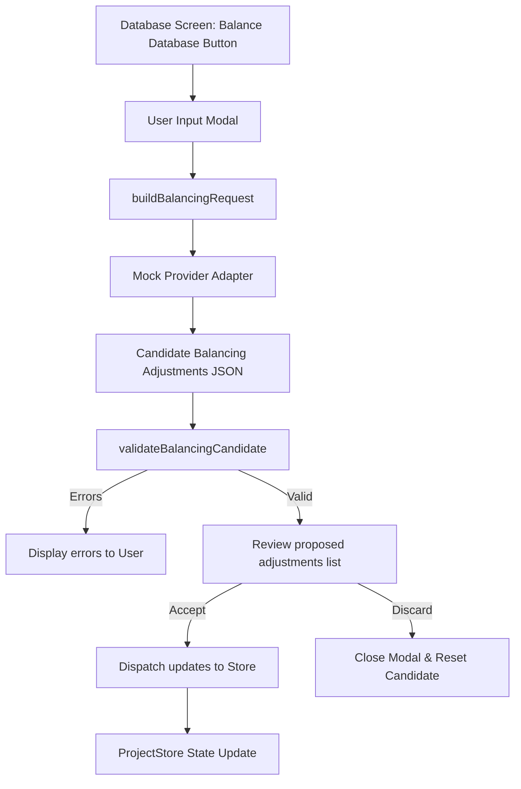

# PHASE_11_AI_BALANCING_ASSISTANT.md — AI Balancing Assistant Documentation

## Overview

The AI Balancing Assistant is an optional design-time utility that enables creators to evaluate and adjust stats, rewards, and pricing across **Actors**, **Enemies**, and **Items** collectively using progression curve configurations and descriptive prompts. 

All operations run local-first, ensuring that applied adjustments maintain correct types, structure limits, and valid reference IDs before saving.

---

## Architecture & Data Flow

### 1. Request Builder & Workflow Layer
- File: [balancingAssistantWorkflow.ts](file:///c:/Users/franc/OneDrive/Escritorio/RPGCreatorAI/src/providers/balancingAssistantWorkflow.ts)
- Merges curve options and the descriptive prompt with current databases (Actors, Enemies, Items) context.
- Returns candidate balancing adjustments structured by table targets.
- Runs validation constraints.

### 2. Validation Constraints
The validator ensures the safety of recommended balancing changes:
- **Identifier Check**: Validates that all adjusted IDs exist in the respective database lists.
- **Stat Ranges**: Enforces non-negative values for stats, Gold rewards, Exp rewards, and Item prices.
- **Types**: Ensures that base stat modifiers and stats are object maps conforming to standard stats keys.

---

## UI Components & Integration

- **Balance Database Action Trigger**: Placed at the right end of the `Database tables` tab bar for global accessibility inside the Database workspace.
- **Generator Modal**: Supports choosing a progression curve (Standard, Fast Scaling, Slow Scaling, Hard Mode) and entering a custom prompt.
- **Adjustments Review details**: Shows lists of affected Actors, Enemies, and Items with details of the changes.
- **Accept and Apply**: Dispatches `UPDATE_DATABASE_ENTRY` for Actors and Enemies, and `UPDATE_ITEM_DATABASE` for Items.

---

## Verification & QA

- **Unit Tests**: `src/providers/__tests__/balancingAssistantWorkflow.test.ts`
  - Tests request formatting, mock adjustments candidate output, validation rules, and approvals.
- **UI Integration Tests**: `src/components/database/__tests__/BalancingAssistantIntegration.test.tsx`
  - Tests sparkles balance button click, modal options, adjustments preview rendering, and accept dispatch mapping.
