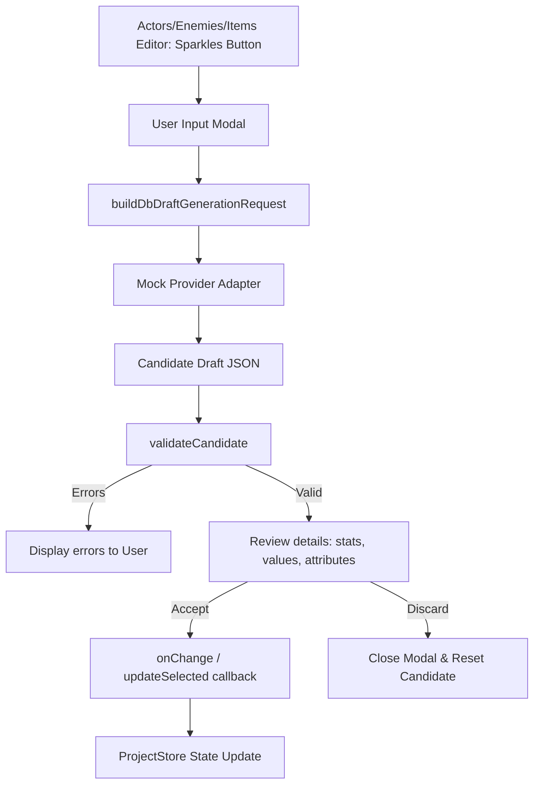

# PHASE_11_AI_DATABASE_DRAFT_GENERATOR.md — AI Database Draft Generator Documentation

## Overview

The AI Database Draft Generator is a design-time assistant integrated directly into the detail editors for **Actors**, **Enemies**, and **Items**. It enables creators to generate structured draft entries or populate details using offline-mocked provider responses based on custom prompts.

All operations run local-first, respecting local type schemas and validating references (like existing classes or items) before applying the generated properties.

---

## Architecture & Data Flow

### 1. Request Builder & Workflow Layer
- File: [dbDraftGenerationWorkflow.ts](file:///c:/Users/franc/OneDrive/Escritorio/RPGCreatorAI/src/providers/dbDraftGenerationWorkflow.ts)
- Handles request structure and generates mock candidates for `actor`, `enemy`, and `item` types.
- Provides specialized validation logic for each type.

### 2. Validation Constraints
The validation checks candidate structure and content rules offline:
- **Actors**:
  - Enforces that level is a positive integer.
  - Enforces non-negative values for HP and MP.
  - Checks if the generated `classId` exists in the current project context classes.
  - Enforces non-negative base stats.
- **Enemies**:
  - Enforces non-negative values for Exp and Gold rewards.
  - Checks if all drop items exist in the project context items list.
  - Enforces that drop rate is a number between 0 and 1.
- **Items**:
  - Enforces non-negative price.
  - Enforces category exists in the project context categories.
  - Validates numeric effects and modifiers.

---

## UI Components & Integration

- **Sparkles Button**: Positioned adjacent to the name input fields in `ActorsEditor`, `EnemiesEditor`, and `ItemsEditor`.
- **Generator Modal**: Prompts the user for a description (e.g., "A fiery fire sword that deals burning damage") and triggers generation.
- **Candidate Review Details**: Displays the parsed draft properties (e.g., Stats, HP/MP, Rewards, Drop lists, price) with provenance metadata.
- **Accept and Apply Action**: Calls the `onChange` or `updateSelected` callback to apply changes to the editor.

---

## Verification & QA

- **Unit Tests**: `src/providers/__tests__/dbDraftGenerationWorkflow.test.ts`
  - Validates mock generation, request building, validation edge cases, and approval flows.
- **UI Integration Tests**: `src/components/database/__tests__/DbDraftGenerationIntegration.test.tsx`
  - Tests sparkles buttons click behavior, modal appearance, generate flow, and acceptance state update.
