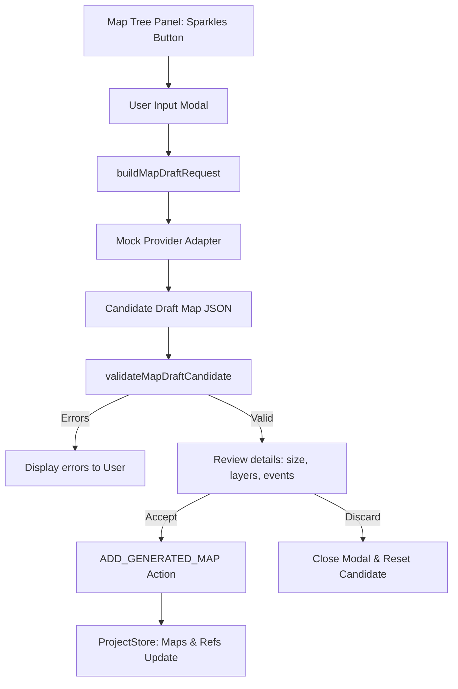

# PHASE_11_AI_MAP_DRAFT_GENERATOR.md — AI Map Draft Generator Documentation

## Overview

The AI Map Draft Generator is a design-time assistant that generates editable map drafts using structured, offline-mocked provider responses. It helps creators generate starting layout templates matching specific scene requirements (e.g. dimensions, tile palettes, and NPC events) without introducing runtime dependencies, network queries, or API key exposures.

All operations are executed local-first:
- Input parameters: Map Name, Parent Map reference, Scene Template, and a custom AI Prompt.
- Context validation: The generator passes available tilesets and resolves default tileset IDs.
- Insertion flow: Approved drafts are inserted directly as editable, playtestable map data in the project tree via the standard project reducer.

---

## Architecture & Data Flow

### 1. Request Builder
- File: [mapDraftGenerationWorkflow.ts](file:///c:/Users/franc/OneDrive/Escritorio/RPGCreatorAI/src/providers/mapDraftGenerationWorkflow.ts)
- Merges the user's custom prompt with visual guidelines and default tileset identifiers.

### 2. Validation Constraints
The validation checks candidate structure and content rules offline before any insertion:
1. **Dimensions**: Verifies map width, height, and tile size are positive integers.
2. **Tileset References**: Enforces that the draft matches an active tileset defined in the project databases context.
3. **Layer Completeness**: Expects exactly the five canonical layers (`ground`, `decoration`, `foreground`, `collision`, `region`) with corresponding roles and types.
4. **Tile Integrity**:
   - Compares visual layer tile IDs against the referenced tileset's tile definitions.
   - Enforces that collision overlay tiles utilize allowed collision codes (e.g., `0` for passable, `1` for blocked).
   - Enforces that region overlay tiles utilize allowed region values (e.g., integers `0-255`).
5. **Event Duplicates**: Asserts that generated event IDs are unique inside the map draft to prevent naming collisions.

### 3. Reducer Integration
- File: [projectStore.ts](file:///c:/Users/franc/OneDrive/Escritorio/RPGCreatorAI/src/stores/projectStore.ts)
- Dispatches the `ADD_GENERATED_MAP` action.
- Creates both the map contents record and inserts the map reference node into the map hierarchy tree under the specified parent node, or at root.
- State mutation is fully immutable and supports undo/redo operations.

---

## UI Components & Interaction

The interface resides within the **Map Tree** panel:
- **Sparkles Icon Button**: Triggers the "Generate Map Draft" modal overlay.
- **Generator Form**: Allows selecting parent map, aspect ratio templates (e.g., Story Room 16:9), naming the draft, and inputting custom prompts.
- **Candidate Review Details**: Shows a tabular list of size, layers, and events when draft generation succeeds.
- **Accept and Insert Action**: Dispatches the accepted draft map, updates the project tree, highlights the new map in the editor, and closes the modal.
- **Discard Action**: Closes the modal without applying changes to the project state.

---

## Verification & QA

The feature is verified end-to-end using automated unit and integration tests:

### 1. Mock Provider Contract
- **File**: `src/providers/__tests__/mapDraftGenerationWorkflow.test.ts`
- Verifies that draft request creation, candidate building, error handling, and candidate validation function correctly.

### 2. Reducer Unit Tests
- **File**: `src/stores/__tests__/projectReducer.test.ts`
- Verifies that dispatching `ADD_GENERATED_MAP` inserts map data correctly, creates references with valid ordering, and respects undo/redo history boundaries.

### 3. MapTreePanel Integration Tests
- **File**: `src/components/editor/__tests__/MapTreePanel.test.tsx`
- Simulates clicking the sparkles icon button, filling options, clicking "Generate Draft", displaying the preview panel, and selecting "Accept & Insert".
