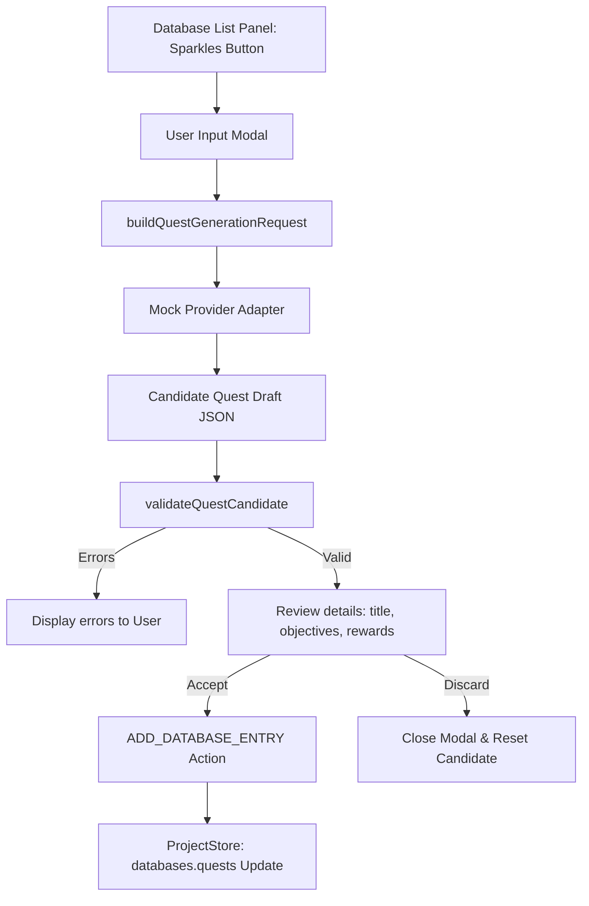

# PHASE_11_AI_QUEST_GENERATOR.md — AI Quest Generator Documentation

## Overview

The AI Quest Generator is a design-time assistant that helps creators generate structured draft quests using offline-mocked provider responses. Approved quests are inserted directly into the project database as fully editable, standard Quest records.

All operations are executed local-first:
- Input parameters: Quest Title and custom AI Prompt.
- Context validation: The generator passes available items as reward candidate metadata.
- Insertion flow: Approved drafts are inserted directly as editable quest records via the standard database reducer.

---

## Architecture & Data Flow

### 1. Request Builder
- File: [questGenerationWorkflow.ts](file:///c:/Users/franc/OneDrive/Escritorio/RPGCreatorAI/src/providers/questGenerationWorkflow.ts)
- Merges the user's custom prompt with visual guidelines and available items metadata.

### 2. Validation Constraints
The validation checks candidate structure and content rules offline before any insertion:
1. **Identifiers**: Enforces that Quest ID and Title are non-empty strings.
2. **Objectives**:
   - Objective list must be an array.
   - Enforces non-empty IDs and descriptions.
   - Ensures objective IDs are unique within the quest.
3. **Rewards**:
   - Enforces non-negative numbers for gold and exp rewards.
   - Reward items must reference existing item IDs in the project context.
   - Enforces positive quantities for reward items.

---

## UI Components & Interaction

The interface resides within the **Database** workspace:
- **Sparkles Icon Button**: Positioned in the `DatabaseList` toolbar next to the "New quest" button when the active tab is "Quests".
- **Generator Form**: Allows specifying the quest title and a custom descriptive prompt.
- **Candidate Review Details**: Displays the parsed details (Gold, Exp, Item rewards, Objectives) when draft generation succeeds.
- **Accept and Insert Action**: Dispatches the accepted quest candidate to the database store and selects it in the list.
- **Discard Action**: Closes the modal without applying changes to the project state.

---

## Verification & QA

The feature is verified end-to-end using automated unit and integration tests:

### 1. Mock Provider Contract
- **File**: `src/providers/__tests__/questGenerationWorkflow.test.ts`
- Verifies that quest request creation, candidate building, error handling, and candidate validation function correctly.

### 2. UI Integration Tests
- **File**: `src/components/database/__tests__/QuestGenerationIntegration.test.tsx`
- Simulates opening the modal, clicking "Generate Draft", showing the review panel, and accepting the insertion.
